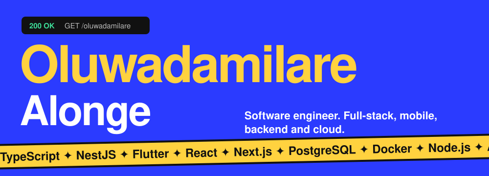
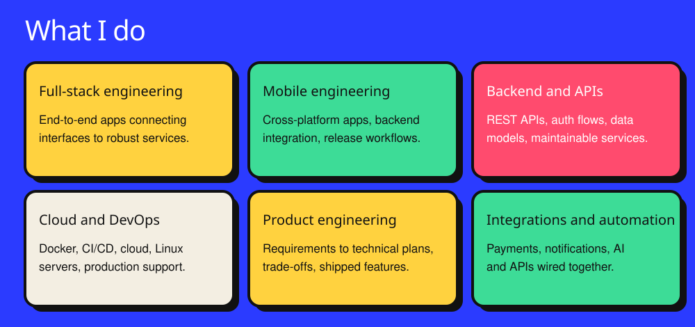

**I turn complex problems into reliable, scalable software.**

---

## About me

I design, develop, deploy and improve production-ready applications, across the whole lifecycle: understanding the problem, shaping the approach, building it and supporting it in production.

My experience spans **healthcare technology, fintech, education and on-demand platforms**, across web, mobile, backend systems, databases and cloud infrastructure. I bring a product mindset: user needs, business goals, reliability and the long-term impact of technical decisions.

- 🧩 **What I build:** web platforms, cross-platform mobile apps, backend services, API-driven systems
- ⚙️ **Core strengths:** backend, full-stack, mobile, API design, infrastructure
- 🔍 **Exploring:** system design, offline-first apps, AI-enabled workflows, application security
- 🎮 **Off the clock:** gaming, learning, trying new tech

## Toolkit

## GitHub stats

 

 

## Let's talk

I'm open to connecting with engineers, founders and teams building meaningful products. Reach me at [oluwadamilare.alonge@gmail.com](mailto:oluwadamilare.alonge@gmail.com).

<i>“Great software is more than code. It’s thoughtful problem-solving, purposeful engineering, and technology that makes a difference.”</i>

